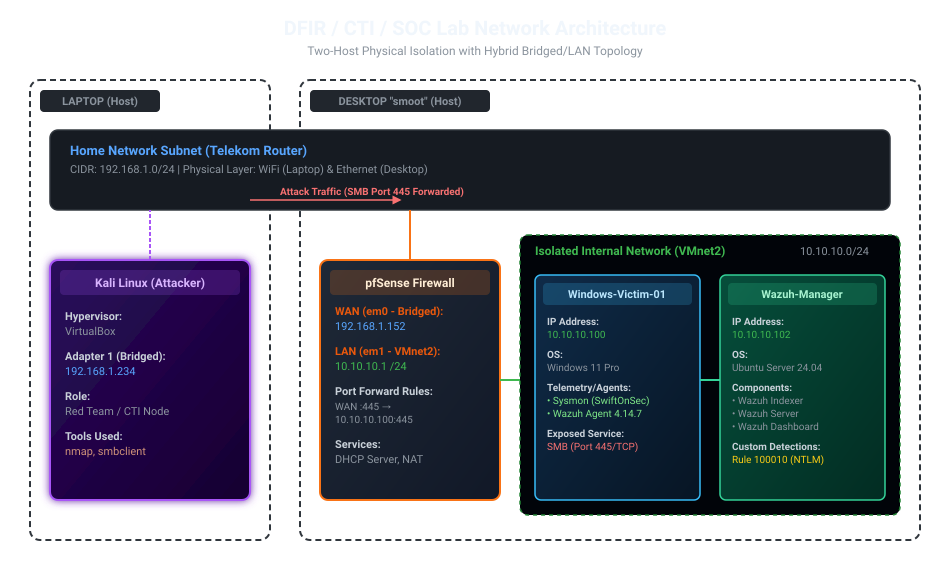

# Cybersecurity Home Lab — DFIR & CTI Focus

**Author:** Haris Dacić — [LinkedIn](https://www.linkedin.com/in/dacicharis/) · [TryHackMe](https://tryhackme.com/p/harisD)
**Focus areas:** Digital Forensics & Incident Response · Cyber Threat Intelligence · SOC Operations

## At a glance

* **4** purple-team exercises, each documented as an incident-style writeup mapped to MITRE ATT&CK
* **9** custom Wazuh rules: 3 for Windows attack behaviour (two of them correlation rules), 6 matching pfSense firewall logs against CTI-derived indicator lists
* **3** CTI reports built from OpenCTI/MISP indicator data (KrustyLoader, ArcaneDoor, Secret Blizzard)
* **pfSense → Wazuh** syslog pipeline with a custom decoder and CDB threat-intel lists
* **Wazuh → Shuffle → Slack** alert forwarding for level 7 and above

---

## Why this exists

This repository documents a self-built security lab and the work done in it: network segmentation with a pfSense firewall, a Wazuh SIEM, purple-team exercises against Windows and Linux targets, and detection engineering driven by threat intelligence. It runs on two consumer PCs and is documented the way a SOC team documents its work: timeline, findings, detection analysis, root cause, recommendations.

---

## Architecture

Two physically separate machines, deliberately split by role — a Blue Team
system and a Red Team system — connected only through the home network, to
keep the exercises realistic and the defensive side genuinely isolated.

```
┌─────────────────────────────────────────┐          ┌──────────────────────────┐
│  DESKTOP — Blue Team / SOC              │          │  LAPTOP — Red Team / CTI │
│  (Ryzen 7 3700X · 16GB · VMware WS Pro) │          │  (i5 12th gen · VirtualBox)│
│                                         │          │                          │
│  ┌─────────────┐                        │          │  ┌────────────────────┐  │
│  │  pfSense CE  │  WAN (bridged) ─────────┼───home─┼─►│  Kali Linux        │  │
│  │  firewall/GW │                         │  network│  (attacker)         │   │
│  └──────┬───────┘                         │        │  └────────────────────┘  │
│         │ LAN 10.10.10.0/24               │        │  ┌────────────────────┐  │
│  ┌──────┴───────┐   ┌──────────────────┐  │        │  │  OpenCTI / MISP    │  │
│  │ Windows 11    │   │  Wazuh Manager   │  │       │  │  (27 svc, 3 feeds)    │
│  │ target        │──►│  SIEM/XDR        │  │       │  └────────────────────┘  │
│  │ + Sysmon      │   │  + Dashboard     │  │       │                          │
│  └───────────────┘   └──────────────────┘  │       │                          │
└─────────────────────────────────────────┘          └──────────────────────────┘
```

*(Full diagram with IPs and NAT flow in* [*`network-diagrams/`*](./network-diagrams)*)*



---

## Stack

|Layer|Tools|
|-|-|
|Hypervisors|VMware Workstation Pro, Oracle VirtualBox|
|Network / Firewall|pfSense CE (firewall logs forwarded to Wazuh over syslog)|
|SIEM / XDR|Wazuh (Indexer + Manager + Dashboard), custom decoder, rules and CDB threat-intel lists|
|Endpoint telemetry|Sysmon (SwiftOnSecurity config)|
|Offensive tooling|Kali Linux, nmap, smbclient, enum4linux, Impacket (psexec, secretsdump)|
|CTI|OpenCTI, MISP (3 feeds: ThreatFox, CIRCL OSINT, URLhaus)|
|SOAR|Shuffle (Wazuh alerts forwarded to Slack via webhook, working)|

---

## Repository structure

|Folder|Contents|
|-|-|
|[`dfir-writeups/`](./dfir-writeups)|Full incident-style reports for each purple team exercise — timeline, technical findings, detection analysis, root cause, recommendations|
|[`detection-rules/`](./detection-rules)|Custom Wazuh detection rules, decoders and threat-intel lists written for specific attack patterns observed in this lab|
|[`network-diagrams/`](./network-diagrams)|Network topology and NAT/routing diagrams|
|[`cti-reports/`](./cti-reports)|Threat intelligence analyses (APT/malware campaigns) using OpenCTI/MISP|
|[`docs/`](./docs)|Lab build documentation, [SOAR integration and detection-engineering lessons learned](./docs/soar-shuffle-and-lessons-learned.md)|
|[`screenshots/`](./screenshots)|Supporting evidence referenced in writeups|

---

## Exercises so far

|#|Title|Techniques|Status|
|-|-|-|-|
|01| [External SMB Exposure & Detection](./dfir-writeups/01-external-smb-exposure-purple-team-exercise.md)|T1046 Network Service Scanning, T1021.002 SMB/Admin Shares, T1078 Valid Accounts|Complete|
|02| [SSH Brute-Force Attack Against Linux Target](dfir-writeups/02-ssh-bruteforce-linux-victim.md) | T1110 Brute Force, T1078 Valid Accounts | Complete |
|03| [Lateral Movement via SMB Admin Shares to SYSTEM-Level Code Execution](./dfir-writeups/03-smb-admin-shares-lateral-movement.md) | T1021.002 SMB/Admin Shares, T1569.002 Service Execution, T1059.003 Windows Command Shell | Complete |
|04| [Credential Dumping via Impacket secretsdump.py](./dfir-writeups/04-credential-dumping-impacket.md) | T1003 OS Credential Dumping, T1003.002 Security Account Manager, T1078 Valid Accounts | Complete |

More exercises are added as the lab grows — each one documented as a
standalone incident report, not just a log of commands run.

---

## CTI Reports so far

|#|Title|Threat/Topic|Status|
|-|-|-|-|
|01| [KrustyLoader — Rust-Based Loader Linked to Ivanti Connect Secure Zero-Days](./cti-reports/01-krustyloader-ivanti-connectsecure.md) | CVE-2023-46805, CVE-2024-21887, T1190 | Complete |
|02| [ArcaneDoor — Espionage-Focused Campaign Against Perimeter Network Devices](./cti-reports/02-arcanedoor-perimeter-devices.md) | Cisco ASA/FTD, T1133 | Complete |
|03| [Frozen in Transit — Secret Blizzard's ISP-Level AiTM Campaign](./cti-reports/03-secret-blizzard-frozen-in-transit.md) | Turla/Secret Blizzard, T1557, ApolloShadow | Complete |

Built from indicators ingested into this lab's OpenCTI instance via the CIRCL
OSINT MISP feed — not a summary of an existing report, but original analysis
built from raw STIX/IOC data.

---

## Detection rules so far

|Rule|Detects|MITRE|Type|
|-|-|-|-|
|[100010](./detection-rules/100010-external-ntlm-logon.md)|NTLM network logon from outside the lab LAN|T1550.002|Custom|
|[100011](./detection-rules/100011-psexec-lateral-movement-correlation.md)|PsExec-style lateral movement (service creation + suspicious process)|T1021.002, T1569.002, T1059.003|Correlation|
|[100012](./detection-rules/100012-credential-dumping-correlation.md)|Remote credential dumping (privileged logon + service config change)|T1003, T1003.002, T1078|Correlation|
|[100020–100023](./detection-rules/100020-100023-arcanedoor-cdb-correlation.md)|pfSense traffic from/to ArcaneDoor IPs, tiered by Talos classification: actor-controlled (level 12) and multi-tenant (level 8) (CTI Report #02)|T1133|CTI-driven|
|[100024 / 100025](./detection-rules/100024-100025-secretblizzard-cdb-correlation.md)|pfSense traffic from/to Secret Blizzard AiTM IP (CTI Report #03)|T1557|CTI-driven|
|[5763 / 40112](./detection-rules/5763-40112-ssh-bruteforce-builtin-rules.md)|SSH brute force (Wazuh built-in rules, analyzed)|T1110|Built-in|

---

**Validation note (rules 100020–100025):** all six rules were validated with `wazuh-logtest` using synthetic pfSense log lines. The initial single-list ArcaneDoor version was also confirmed by a live scan from the Kali VM; live traffic was not repeated for the tiered rules or for 100024/100025. Known limitations and the debugging record are in [lessons learned](./docs/soar-shuffle-and-lessons-learned.md).

---

## Milestones

* [x] Linux target with auditd, for cross-platform detection coverage
* [x] Lateral movement (SMB Admin Shares) and credential dumping exercises
* [x] Custom Wazuh rules: correlation rules 100011/100012 validated against live attack traffic; CTI-driven rules 100020–100025 validated as described in the validation note above
* [x] OpenCTI populated with public threat intel (ThreatFox, CIRCL OSINT, URLhaus); three CTI reports published
* [x] SOAR with Shuffle: Wazuh alerts of level 7 and above forwarded to Slack #soc-alerts, confirmed with a real Wazuh alert

---

## Contact

Open to junior SOC / DFIR / CTI roles, remote or relocation.
[LinkedIn](https://www.linkedin.com/in/dacicharis/) · [TryHackMe profile](https://tryhackme.com/p/harisD)
 
